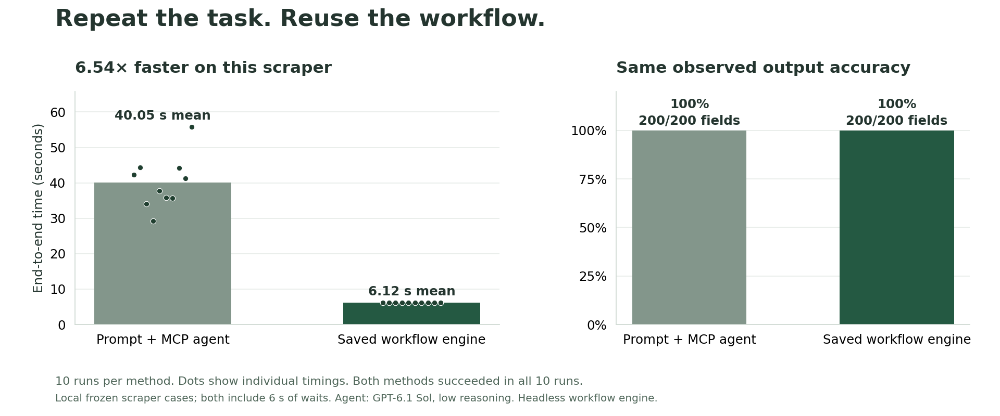
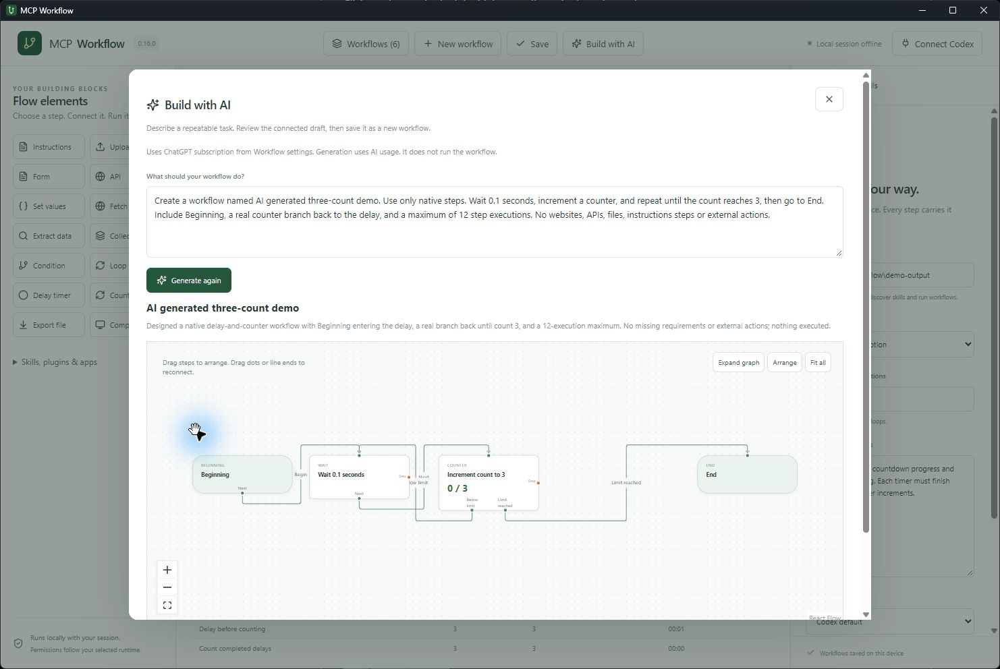

# MCP Workflow

**Create a task once. Run it again whenever you need.**

A desktop AI automation builder for prompts, files, forms, APIs and web scraping. Connect steps, add branches and loops, and watch the active step glow until the task finishes. Tools run behind the scenes.

Current version: **0.17.1** · Tauri + React + Rust · Desktop AI automation

[Comparison](#comparison-with-prompt-driven-mcp-agents) · [Demo](#amazon-scraper-demo) · [Build with AI](#build-a-workflow-with-ai)

## Comparison with prompt-driven MCP agents

**The saved workflow engine finished our repeatable scraper task 6.54× faster: 6.12 seconds versus 40.05 seconds on average. Both approaches produced correct output in every trial.**



| Measured result | Prompt + MCP agent | Saved native workflow (no AI steps) |
| --- | ---: | ---: |
| Average completion time | 40.05 s | **6.12 s** |
| Median completion time | 39.51 s | **6.12 s** |
| Fastest–slowest run | 29.25–55.79 s | 6.10–6.17 s |
| Successful runs | 10/10 | 10/10 |
| Correct expected fields | 200/200 (100%) | 200/200 (100%) |
| Changed-input cases, without editing the prompt/flow | 5/5 correct | 5/5 correct |
| Average model tokens per run, including cached input | 153,304.4 | **0** |
| Model inference during each run | Yes | No, native steps only |

**What we tested:** ten paired runs on the same two fictional catalog pages, with the same native parsing and file-writing functions, first-occurrence deduplication, CSV/JSON requirements and six seconds of deliberate waits. Five pairs changed the data. The agent used **GPT-6.1 Sol, low reasoning**, through a ChatGPT subscription. All output files and timing summaries were independently audited. Measured October 30, 2026.

**Why use it for repeatable work:** save the execution plan once, then reuse native steps without asking a model to choose every action again. This benchmark measures the headless workflow engine, not UI rendering, live Amazon scraping or AI-heavy steps. It shows a speed benefit on this task and **no observed accuracy advantage**. Agents that reuse scripts or higher-level tools are a different baseline.

**[Download the measured comparison spreadsheet](outputs/2026-10-30-mcp-comparison/mcp-workflow-comparison.xlsx)** · [All 20 trial records and output files](benchmarks/results/measured-2026-10-30T08-02-42-177Z) · [Methodology and limitations](docs/comparison.md) · [Reproduce the benchmark](scripts/benchmark/README.md)

<details>
<summary>Model tokens used in every measured run</summary>

**Why zero?** This saved scraper uses code-based decisions: check whether `nextUrl` exists, follow the configured branch, and count page repetitions. These operations use CPU time but do not send prompts to a model, so they consume **0 model tokens during repeat execution**. This does not mean the application always uses zero tokens.

**Scope:** the comparison is a fresh AI agent versus a prebuilt native scraper. Workflows containing Instructions or other AI steps do consume model tokens. AI builder/authoring tokens were **not measured** here, so these numbers do not compare the full cost from an initial prompt to a finished automation, or two AI-driven workflows.

| Pair | Agent total | Input | Of which cached | Output | Native repeat-run model tokens |
| --- | ---: | ---: | ---: | ---: | ---: |
| 1 | 182,967 | 181,332 | 143,232 | 1,635 | 0 |
| 2 | 185,533 | 183,586 | 163,968 | 1,947 | 0 |
| 3 | 142,184 | 141,586 | 122,880 | 598 | 0 |
| 4 | 115,581 | 114,274 | 104,576 | 1,307 | 0 |
| 5 | 118,116 | 116,178 | 83,456 | 1,938 | 0 |
| 6 | 116,407 | 114,822 | 82,048 | 1,585 | 0 |
| 7 | 118,093 | 116,177 | 97,408 | 1,916 | 0 |
| 8 | 185,326 | 183,388 | 172,800 | 1,938 | 0 |
| 9 | 183,042 | 181,415 | 170,880 | 1,627 | 0 |
| 10 | 185,795 | 183,824 | 164,224 | 1,971 | 0 |
| **Average** | **153,304.4** | 151,658.2 | 130,547.2 | 1,646.2 | **0** |

These are cumulative model tokens for the full agent run, including repeated context across model calls. **Total = input + output**. Cached input is already included in input; it is not added again. The native graph used no model during these runs. AI-builder/setup tokens and AI-heavy steps are excluded. Token counts are not dollar costs.

</details>

<details>
<summary>Compare features, flexibility and current limitations</summary>

| Area | Agent given a prompt and MCP tools | MCP Workflow |
| --- | --- | --- |
| First-time setup | Describe the task and start; often simpler for one-off work | Generate or build a graph, review it, then run |
| Speed on repeated tasks | May plan again; some hosts reuse plans or scripts | Reuses saved steps; native steps avoid AI inference |
| Speed on AI-heavy tasks | Depends on model, tools and service latency | Uses the same provider; separate step turns can add overhead |
| Output accuracy | Depends on instructions, model, tools and validation | Fixed native rules are consistent; AI steps can still make mistakes |
| Accuracy when reused | The same prompt can lead to different execution paths | Saved routes and fields repeat; incorrect rules repeat errors too |
| Reusability | Save the prompt or have the agent create reusable scripts | Named workflows, templates and JSON import/export |
| Creating flows with AI | Agent can describe a plan in conversation | **Build with AI** creates a connected draft to review and save |
| Branches and loops | Agent interprets the prompt at runtime | Explicit conditions, loops, counters and execution limits |
| Error recovery | Depends on the agent host and instructions | Configurable retries, inactivity timeout and error paths |
| Visibility | Conversation and tool traces vary by host | Active-step glow, countdowns, counters and live CSV |
| Cost | Depends on model usage, tools and billing | Native steps need no model inference; AI steps and generation do |
| Flexibility | Useful for exploration and changing requirements | Useful for recurring tasks with known inputs and outputs |
| Scheduling | Available in some agent hosts | Manual runs only; delays do not resume after shutdown |

</details>

## Amazon scraper demo

Watch the workflow beside the demo pages, with conditions, pagination and a CSV filling in real time.

https://github.com/user-attachments/assets/5cc4b2e4-184b-478b-a4ba-59ce069c23c0

## Try it yourself

1. Open the desktop app and click **Scraper demo**.
2. In **Workflow settings**, choose an existing workspace folder.
3. Open **Live view**, then **Run workflow** to see the fetched page beside the graph and the actual CSV fill after each page. Use **Show CSV** for the completed file.

The Amazon-style example uses **fictional bundled pages**. It fetches two pages, extracts products, follows pagination, removes duplicates and saves **five products** as CSV and JSON. No account or live Amazon access is required. This is a basic demonstration of how the tool works, not an Amazon integration.

[Download the Amazon scraper video](docs/demo/amazon-scraper-demo.mp4) · [Template JSON](examples/amazon-scraper-demo.json) · [Example output](docs/demo/products.json)

## Build a workflow with AI

Choose a workspace and AI provider in **Workflow settings**, then click **Build with AI**. Describe the task, generate a draft, and review its graph, instructions and missing inputs. Click **Save as new workflow**, finish any required settings, and run it when ready. Your existing flows stay in the library.

For example: “Read uploaded quotes, compare prices, and fill a form with the best supplier. Report missing information instead of guessing.” AI can also design branches, bounded loops, counters, delays and API steps. Check page selectors, credentials and write operations before running. Generation uses the selected provider and does not execute the workflow.



## Save and manage workflows

Use **New workflow** to give a flow a name and description. Edits save automatically on this device; **Save** writes the library immediately. **Workflows** lists your saved flows so you can search, open, export or delete them. Deleting asks for confirmation and removes that flow’s run statistics.


Use **Import JSON** to add an independent copy, or **Export workflow** to download the current flow as JSON. Imports and the scraper demo keep your other workflows. JSON contains the workflow definition and file references; uploaded file contents, credentials and run statistics are not bundled.

## Connect, branch, loop and recover

Every graph includes **Beginning** and **End**. Drag steps to redesign the layout. Drag a connector dot to another step, or drag an existing line end to reconnect it. True/False, Repeat/Done and Error paths have their own connectors. Zoom, fit all or expand the graph to explore larger workflows.

Open a step’s **Retries & recovery** to choose retries, retry delay, inactivity timeout and an error destination. Retries wait for the previous attempt to stop; waiting for your approval pauses the inactivity timer. Retrying can repeat external actions, so retries default to zero.

Click **Loops demo** for a working [conditions, loops and recovery example](examples/conditions-and-loops.json). It intentionally fails a missing optional input, retries once, recovers to a default, branches on a condition, completes three loop iterations and reaches End. It needs no AI account.

## Delay and count repetitions

**Delay timer** waits before the next step and shows its remaining time in the graph and console. Choose seconds, minutes, hours or days. **Counter** increments on each completed visit and takes either its Below limit or Limit reached path. Counts reset for every run.

Try [Delay and count three repetitions](examples/counter-and-delay.json): Beginning → Delay → Counter → back to Delay until count 3 → End. The scraper demo also counts fetched pages. [Watch countdowns and counter branching](docs/demo/counter-timer-demo.mp4).

## Build your own flow

Click an element in the left sidebar, configure it, then choose its next step.

| Element | Use it to… |
| --- | --- |
| Instructions | Tell the AI what to do in plain language |
| Upload / Form | Supply files or collect AI-filled structured answers |
| API | Make GET, POST, PUT, PATCH or DELETE calls; or describe an operation for AI |
| Set values | Define inputs and update variables |
| Fetch page / Extract data | Read HTML and select rows, text and attributes |
| Collect rows / Export file | Remove duplicates and save CSV or JSON |
| Condition / Loop / Counter | Branch, repeat groups, and count completed repetitions |
| Delay timer | Wait in seconds, minutes, hours or days, with a live countdown |
| Computer task | Interact with a browser or app when a compatible runtime is available |

**Great first flows:**

- **Compare documents:** Upload → Instructions (“compare the quotes; never guess missing prices”) → Form.
- **Scrape a catalog:** Set URL → Wait → Fetch → Extract → Collect → Condition → next page or Export.
- **Process API records:** API GET → Instructions → Form → API update.

Every action finishes before routing to the next step. Each run has fresh data; saved flows are repeatable. Repeating API writes or computer actions can repeat their external effects. The console shows step durations, total time, run counts and average times.

Choose **ChatGPT subscription, Claude subscription, OpenAI API, Claude API or Bedrock** in Workflow settings. Native scraper and direct API steps work without an AI provider. Expand **Skills, plugins & apps** to browse Codex capabilities and download available plugins. Needed Codex plugins are selected automatically; Claude uses its own runtime configuration.

## Run from source

Install Node.js 22.12+, Rust and the [Tauri prerequisites](https://v2.tauri.app/start/prerequisites/).

```sh
npm install
npm run desktop
```

AI steps additionally need the selected provider's runtime and sign-in or credentials. [Setup, references, loops, examples and limits →](docs/guide.md)

Manual runs are supported. Scheduling and unattended operation are not implemented. Live scraping requires permitted access and selectors suited to the site's HTML; JavaScript rendering and access-block bypass are not built into Fetch page.

## Automatic desktop releases

Every **Monday at 09:00 Manila time (01:00 UTC)**, GitHub Actions checks for application or build changes since the last published release. Documentation-only changes are skipped. The first run releases the current application. You can also run **Actions → Weekly desktop release → Run workflow** on the default branch.

A release includes **Windows x64 (.exe)**, **Linux x64 (.AppImage and .deb)**, **macOS Intel + Apple silicon (.dmg)** and **SHA256SUMS**. All three builds and their tests must succeed before publishing. Interrupted uploads stay as a draft and can be retried. Tags include the application version and source revision, so rerunning the same revision does not create another release.

**Release summaries use GitHub Copilot when available.** If installation, authentication, allowance or summary generation fails, a **free local summarizer** groups the real commits into features, fixes and maintenance, with commit links. Every release identifies which summarizer was used. Set the repository variable `RELEASE_SUMMARIZER` to `local` to always use the free fallback. No paid summarizer API is required.

The workflow becomes active after it is pushed to the repository's default branch with Actions enabled. Copilot uses the built-in workflow token and needs the repository owner's applicable entitlement/policy; its usage is not guaranteed free ([GitHub setup and permissions](https://docs.github.com/en/copilot/how-tos/copilot-cli/use-copilot-cli-in-actions)). GitHub-hosted build minutes follow the repository's Actions plan. Scheduled runs may be delayed by GitHub. If GitHub Actions itself is unavailable, publishing waits until the workflow can run again.

Windows packages are unsigned; macOS packages use ad-hoc signing without Apple notarization. macOS/Linux packages are built and tested by their hosted runners; the release workflow must run successfully to verify those platforms. See [the workflow](.github/workflows/weekly-release.yml).

## License

**Free for personal noncommercial use. Commercial use requires a separate paid license.** See [LICENSE](LICENSE) and [commercial licensing](COMMERCIAL-LICENSE.md). Commercial pricing is not set yet.

The code is **source-available under PolyForm Noncommercial**, not GPL or unrestricted open source. GPL permits commercial use, so it does not match this licensing requirement. Dependencies retain their own licenses.
