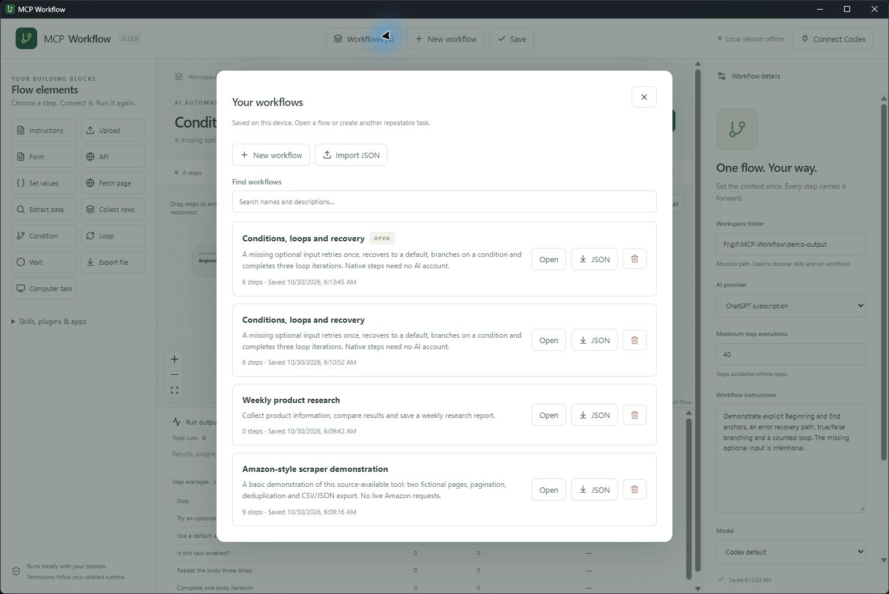

# MCP Workflow

**Create a task once. Run it again whenever you need.**

A desktop AI automation builder for prompts, files, forms, APIs and web scraping. Connect steps, add branches and loops, and watch the active step glow until the task finishes. Tools run behind the scenes.

Current version: **0.15.2** · Tauri + React + Rust · Windows installer

## Amazon scraper demo

Watch the workflow beside the demo pages, with conditions, pagination and a CSV filling in real time.

https://github.com/user-attachments/assets/5cc4b2e4-184b-478b-a4ba-59ce069c23c0

## Try it yourself

1. Open the desktop app and click **Scraper demo**.
2. In **Workflow settings**, choose an existing workspace folder.
3. Open **Live view**, then **Run workflow** to see the fetched page beside the graph and the actual CSV fill after each page. Use **Show CSV** for the completed file.

The Amazon-style example uses **fictional bundled pages**. It fetches two pages, extracts products, follows pagination, removes duplicates and saves **five products** as CSV and JSON. No account or live Amazon access is required. This is a basic demonstration of how the tool works, not an Amazon integration.

[Download the Amazon scraper video](docs/demo/amazon-scraper-demo.mp4) · [Template JSON](examples/amazon-scraper-demo.json) · [Example output](docs/demo/products.json)

## Save and manage workflows

Use **New workflow** to give a flow a name and description. Edits save automatically on this device; **Save** writes the library immediately. **Workflows** lists your saved flows so you can search, open, export or delete them. Deleting asks for confirmation and removes that flow’s run statistics.



Use **Import JSON** to add an independent copy, or **Export workflow** to download the current flow as JSON. Imports and the scraper demo keep your other workflows. JSON contains the workflow definition and file references; uploaded file contents, credentials and run statistics are not bundled.

## Connect, branch, loop and recover

Every graph includes **Beginning** and **End**. Drag steps to redesign the layout. Drag a connector dot to another step, or drag an existing line end to reconnect it. True/False, Repeat/Done and Error paths have their own connectors. Zoom, fit all or expand the graph to explore larger workflows.

Open a step’s **Retries & recovery** to choose retries, retry delay, inactivity timeout and an error destination. Retries wait for the previous attempt to stop; waiting for your approval pauses the inactivity timer. Retrying can repeat external actions, so retries default to zero.

Click **Loops demo** for a working [conditions, loops and recovery example](examples/conditions-and-loops.json). It intentionally fails a missing optional input, retries once, recovers to a default, branches on a condition, completes three loop iterations and reaches End. It needs no AI account.

## Delay and count repetitions

**Delay timer** waits before the next step and shows its remaining time in the graph and console. Choose seconds, minutes, hours or days. **Counter** increments on each completed visit and takes either its Below limit or Limit reached path. Counts reset for every run.

Try [Delay and count three repetitions](examples/counter-and-delay.json): Beginning → Delay → Counter → back to Delay until count 3 → End. The scraper demo also counts fetched pages. [Watch countdowns and counter branching](docs/demo/counter-timer-demo.mp4).

## Build your own flow

Click an element in the left sidebar, configure it, then choose its next step.

| Element | Use it to… |
| --- | --- |
| Instructions | Tell the AI what to do in plain language |
| Upload / Form | Supply files or collect AI-filled structured answers |
| API | Make GET, POST, PUT, PATCH or DELETE calls; or describe an operation for AI |
| Set values | Define inputs and update variables |
| Fetch page / Extract data | Read HTML and select rows, text and attributes |
| Collect rows / Export file | Remove duplicates and save CSV or JSON |
| Condition / Loop / Counter | Branch, repeat groups, and count completed repetitions |
| Delay timer | Wait in seconds, minutes, hours or days, with a live countdown |
| Computer task | Interact with a browser or app when a compatible runtime is available |

**Great first flows:**

- **Compare documents:** Upload → Instructions (“compare the quotes; never guess missing prices”) → Form.
- **Scrape a catalog:** Set URL → Wait → Fetch → Extract → Collect → Condition → next page or Export.
- **Process API records:** API GET → Instructions → Form → API update.

Every action finishes before routing to the next step. Each run has fresh data; saved flows are repeatable. Repeating API writes or computer actions can repeat their external effects. The console shows step durations, total time, run counts and average times.

Choose **ChatGPT subscription, Claude subscription, OpenAI API, Claude API or Bedrock** in Workflow settings. Native scraper and direct API steps work without an AI provider. Expand **Skills, plugins & apps** to browse Codex capabilities and download available plugins. Needed Codex plugins are selected automatically; Claude uses its own runtime configuration.

## Run from source

Install Node.js 20+, Rust and the [Tauri prerequisites](https://v2.tauri.app/start/prerequisites/).

```sh
npm install
npm run desktop
```

AI steps additionally need the selected provider's runtime and sign-in or credentials. [Setup, references, loops, examples and limits →](docs/guide.md)

Manual runs are supported. Scheduling and unattended operation are not implemented. Live scraping requires permitted access and selectors suited to the site's HTML; JavaScript rendering and access-block bypass are not built into Fetch page.

## License

**Free for personal noncommercial use. Commercial use requires a separate paid license.** See [LICENSE](LICENSE) and [commercial licensing](COMMERCIAL-LICENSE.md). Commercial pricing is not set yet.

The code is **source-available under PolyForm Noncommercial**, not GPL or unrestricted open source. GPL permits commercial use, so it does not match this licensing requirement. Dependencies retain their own licenses.
