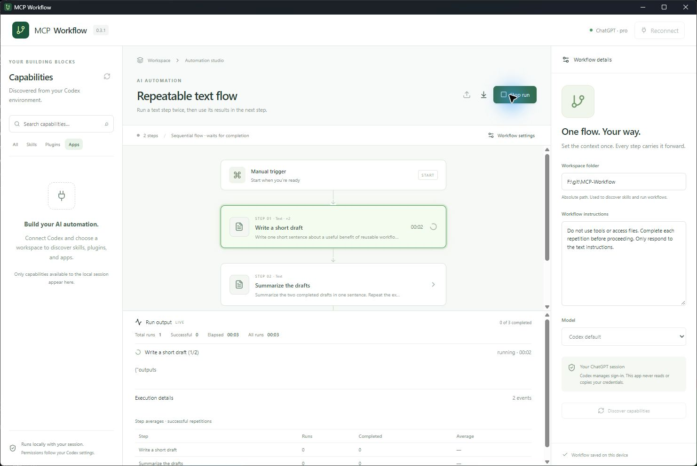
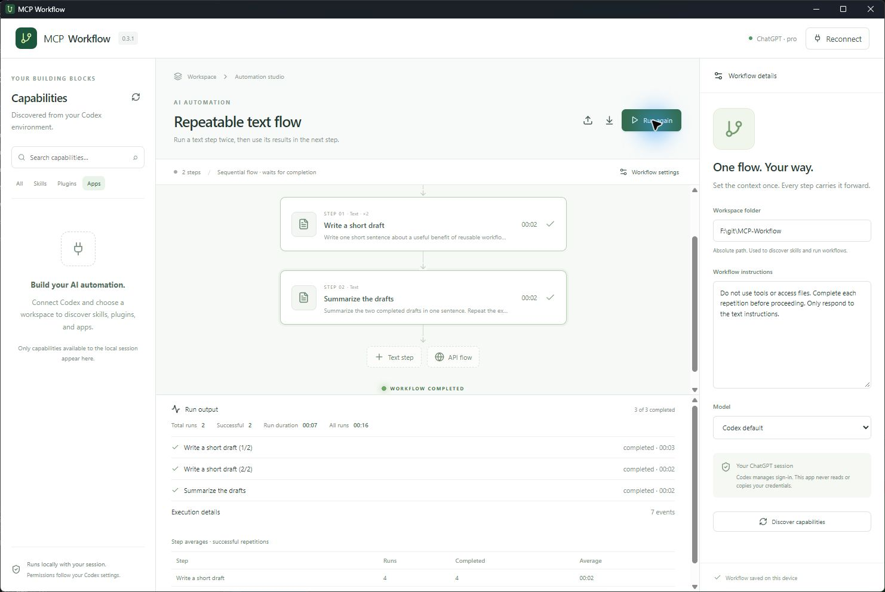
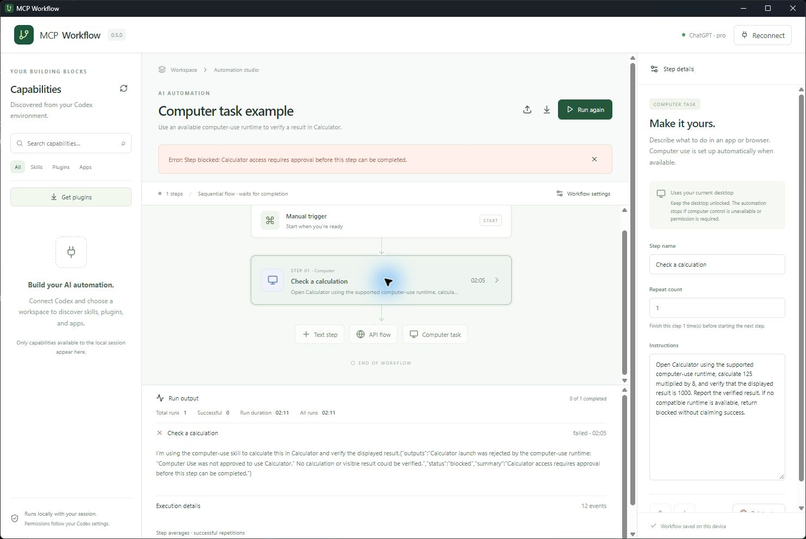
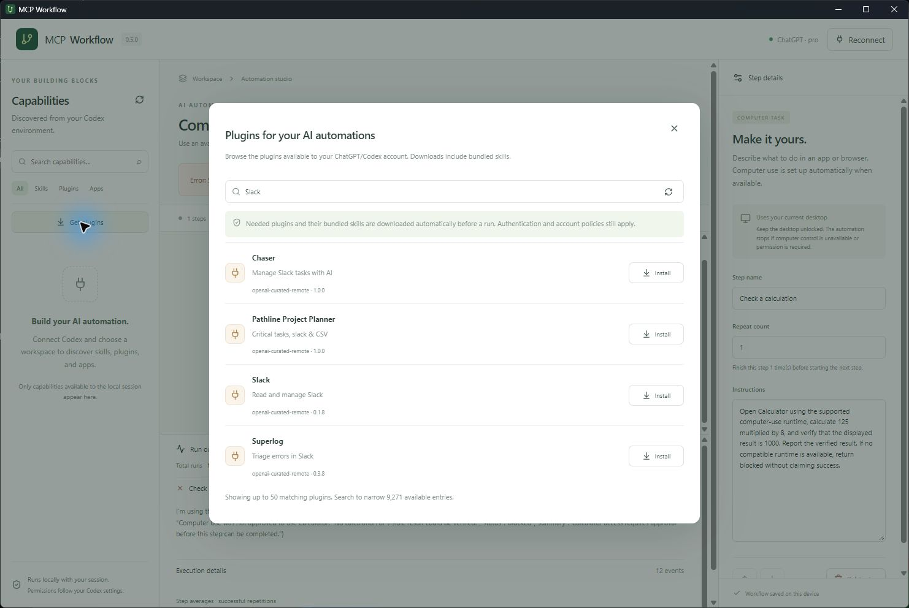
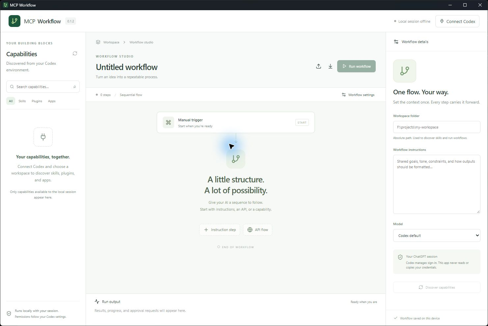
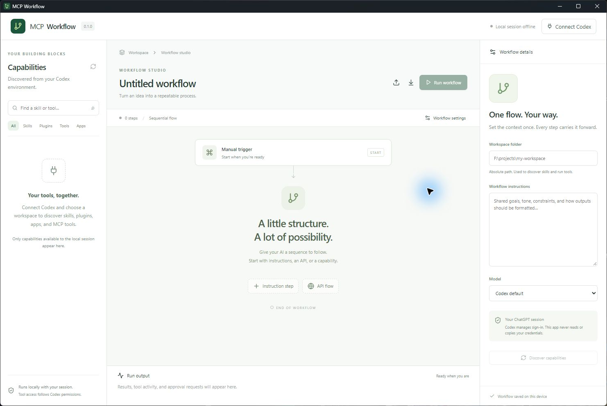
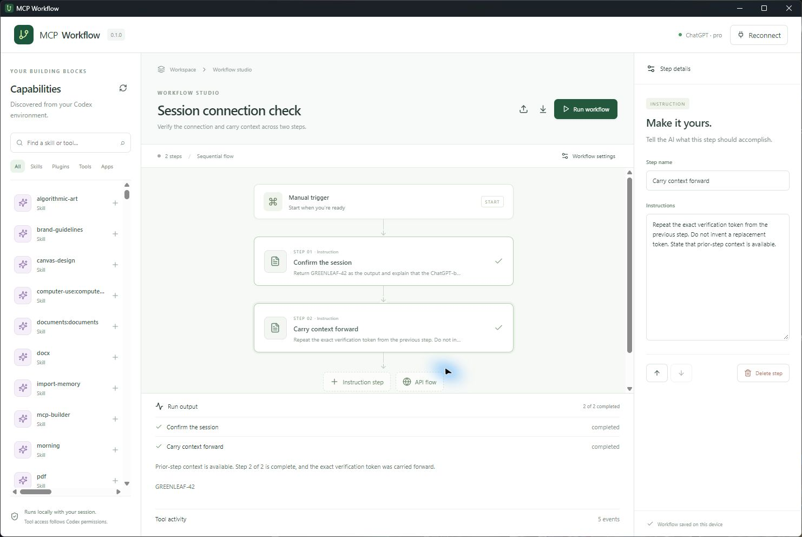
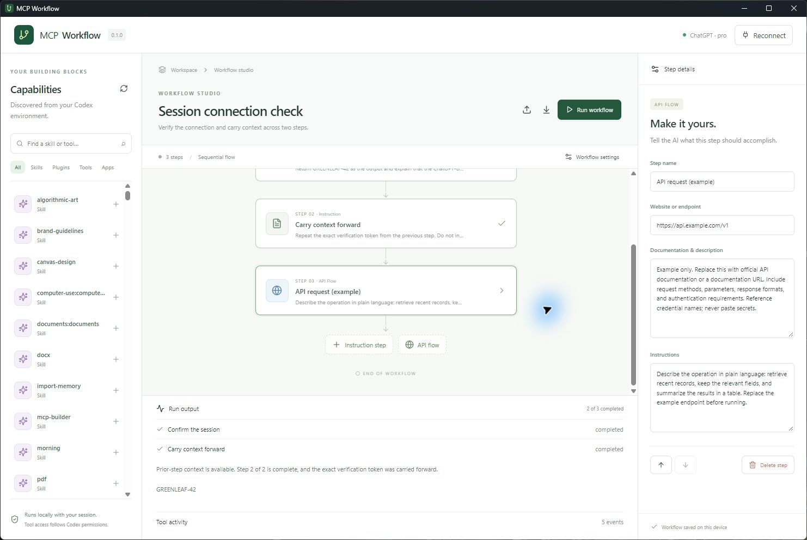
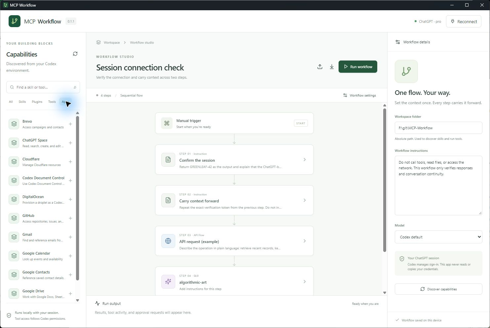

# MCP Workflow

Version **0.10.0**. A Tauri 2 desktop AI automation app using React, TypeScript, and a Rust bridge to local Codex app-server.

MCP Workflow makes repeatable tasks easy to create using AI. Describe what you want in plain language, organize it into steps, and save an automation you can run again whenever needed. Start with a simple Text step, add skills or connected apps when useful, and describe API operations alongside their documentation. Codex chooses the underlying tools automatically. Every step finishes before the next one starts, carries its results forward, and shows progress and timing so you can see what the automation is doing.

Automations currently run on demand through **Run workflow** and **Run again**. Scheduled, unattended, and event-triggered execution are not implemented in this release.

## Screenshots

Actual Windows Tauri application. Earlier screenshots show the original sidebar; version 0.1.2 removes the Tools category and individual tool entries.



















## License

**Free for personal noncommercial use. Commercial use requires a separate paid license.** The source is available under [PolyForm Noncommercial 1.0.0](LICENSE); see [commercial licensing](COMMERCIAL-LICENSE.md) for requests. Pricing and commercial agreements are not configured yet. This release has no payment or license-key enforcement.

PolyForm also permits other noncommercial purposes and qualifying noncommercial organizations under its exact terms. This is a source-available project. It is not GPL: the [GNU GPL permits commercial use and cannot add a commercial-use prohibition](https://www.gnu.org/licenses/gpl-faq.html#NoMilitary). Third-party dependencies retain their own licenses.

## Run

Requires Node.js, Rust, the platform's [Tauri prerequisites](https://v2.tauri.app/start/prerequisites/), and Codex installed. On Windows, the app also discovers the Codex desktop executable. Set `MCP_WORKFLOW_CODEX` to an absolute executable path to override discovery.

```powershell
npm install
npm run desktop
```

Use **Connect Codex**, enter an existing absolute workspace folder, then **Discover capabilities**. The app uses Codex's existing sign-in. If signed out, use **Sign in with ChatGPT** to complete Codex's browser login. A ChatGPT subscription with Codex access is required for subscription-backed runs; the app does not extract browser cookies or copy credentials. Login affects the local Codex account shared with other Codex clients.

The browser-only preview (`npm run dev`) supports workflow editing, import, and export; execution and discovery require the desktop app.

To verify your session, import [examples/connection-check.json](examples/connection-check.json), set your workspace folder, and run it. Its two instruction steps make no tool calls: the second repeats the first step's token to verify conversation continuity. Running it consumes your normal Codex plan allowance.

For an API flow, import [examples/api-starter.json](examples/api-starter.json) and replace the example endpoint, reference documentation, and instructions with your own before running. The included `api.example.com` address is a placeholder, not a working service.

For a plain-language automation with repetitions, import [examples/repeatable-text-flow.json](examples/repeatable-text-flow.json). Its first Text step runs twice, then the second Text step summarizes those results. Set your workspace and connect Codex before running.

## Build a workflow

- Search automatically discovered skills, installed plugins, and accessible apps in the sidebar; click a capability to add a step. Disabled capabilities cannot be added. Individual tools are kept out of the editor: Codex chooses and uses available tools automatically while running your instructions, skills, apps, and API flows. Existing workflow files with explicit tool steps remain compatible.
- The Apps tab lists connected services by name with a short description. Hover an entry for its full description; click it to add an app step. Version 0.1.1 fixes an icon style collision that previously hid app names and distorted app steps.
- Add a **Text step**, type what you want the AI to do, and run it without choosing any capability. Existing instruction steps remain compatible. API flows accept an HTTP(S) website/endpoint, documentation or documentation URLs, and plain-language instructions.
- Every kind of step has a **Repeat count** from 1 to 100 (default 1). A step completes all repetitions before the next step starts. Each repetition has its own result, and outputs remain available to later repetitions and steps. A repeat executes the action again; external writes are not automatically idempotent.
- Set shared workflow instructions and an optional model in workflow settings. Steps run sequentially in one Codex thread, carrying earlier outputs forward. Reorder or delete steps from their details panel.
- Run the workflow to stream results. Optional execution details are collapsed by default. Automatic tool selection still respects Codex permissions: command and file approvals are shown for explicit approval. User-input requests are supported; unsupported requests can be declined. Additional permission requests are conservatively declined by this version. Stop interrupts the active turn and prevents subsequent steps.
- Definitions save automatically to local webview storage. Export/import JSON for backups and sharing. Import replaces the current definition; export first if you want to keep it. Do not include secrets: definitions and exported JSON are plaintext.

## Repeatability and completion

Use **Run again** to replay a saved workflow from the beginning. Each run uses a new Codex thread and a snapshot of the definition, so previous conversation state and edits during execution cannot change the active sequence. The same instructions can produce different AI responses or external results; repeatability does not imply deterministic output. Older definitions without repeat counts run once per step.

Only one execution can start at a time. The executor awaits each repetition's turn completion, validates its structured successful outcome, and checks protocol-reported agent and tool work before advancing. The AI is instructed to wait for delegated agents and background operations and collect their results before declaring completion. If reported work is still running, interrupted, or unsuccessful, the workflow stops rather than launching the next step. These checks cover work visible through the Codex protocol; arbitrary external background processes cannot be independently verified. Failed, blocked, malformed, or interrupted outcomes stop the sequence, and Stop prevents further repetitions or steps.

## Live progress and run statistics

The active step pulses with a green glow and shows its elapsed time. The canvas follows the active step and lights the end marker only when the whole workflow succeeds. Reduced-motion preferences keep the highlight steady. The output console shows live elapsed time for each repetition, its final duration, and the current workflow's total duration. Timing includes time spent waiting for the AI, tools, and approvals; it is measured elapsed time, not an estimated finish time.

The console also shows total workflow runs started, successful workflow runs, cumulative elapsed time across all runs, and a table of step attempts, completions, and average successful completion times. Each repetition counts as one step attempt. Failed/interrupted attempts count toward attempts but not successful averages. Aggregate statistics are saved locally per workflow ID and survive restarting the app. Exported definitions preserve workflow IDs, but statistics are stored separately and are not included in JSON exports. Old definitions receive an ID when loaded. Full output logs remain session-only.

## Plugins and automatic skill downloads

Use **Get plugins** in the sidebar to search your account's available ChatGPT/Codex marketplaces, inspect descriptions and versions, and install or update a plugin. The catalog is refreshed from Codex; installation uses the supported `codex plugin add` CLI rather than the experimental app-server installation endpoint. Required external-service authentication remains with ChatGPT/Codex. Restricted or disabled plugins are not silently enabled.

Before an automation starts, the AI checks the current catalog and selects only the plugins needed for the task, alongside explicit plugin/skill references in the definition. Missing packages and available updates are downloaded automatically, including their bundled skills. Configured Git marketplace snapshots are refreshed before installing a needed package. Already-current packages are reused. Skill discovery is refreshed and skill paths resolved before a fresh execution thread starts. Plain text tasks can select no extra plugins. This dependency check uses the same signed-in Codex account and adds a planning turn to each run; its elapsed time is included in the run duration.

Large catalogs are searchable in pages of up to 50 visible entries. The dependency planner receives a bounded shortlist of up to 60 relevant, installed, featured, or explicitly referenced candidates instead of sending the whole marketplace to the model.

Latest means the version available to the account and configured marketplace/source, respecting pinned references and administrative policies. ChatGPT-only plugins not exposed through the Codex catalog cannot be installed by this app. Standalone locally authored skills are reloaded, not overwritten from unknown sources. Their owning plugin, when known, supplies package updates. Missing authentication, unavailable packages, and failed downloads stop the automation with an error rather than proceeding with a missing capability.

## AI-filled forms

Add **Form**, create named fields, choose text, number, checkbox, email, date, or choice answers, and add hints if needed. The AI fills the form from your instructions and prior steps. Required answers and types are validated before the workflow advances. Unknown required answers stop the step instead of being invented. Results display as a filled local form and can be downloaded as JSON; forms are not submitted to external websites. Try [the form-fill example](examples/form-fill.json).

## Instructions and uploads

Choose **Instructions** to give the AI a plain-language task. Existing Text steps are compatible. Choose **Upload** to select a single file or multiple files using the desktop file picker. Set the workspace first. The app copies up to 100 selected files per selection (50 MB per file) into a unique `.mcp-workflow/uploads-*` folder inside that workspace, preserving them for repeat runs. Removing a reference from a step does not delete the retained file. Exported workflow JSON contains file references, not their contents; reselect files when moving the workflow to another machine. Uploaded content is treated as reference data, and unreadable or unsupported formats must be reported as blockers. The AI can read the files and pass findings to subsequent steps.

## Computer tasks

Add a **Computer task** and describe what to do in an app or browser. Dependency preparation automatically selects the account's `computer-use` plugin, installs it if needed, and supplies its enabled skill to Codex. Computer tasks support the same repetitions, completion gates, progress glow, and timing statistics as other steps. [examples/computer-task.json](examples/computer-task.json) provides a harmless Calculator example.

Actual control requires a compatible local computer-use runtime, an interactive unlocked desktop, and any required host permissions. Plugin installation alone does not create that runtime or grant permissions. The AI follows the installed skill's screenshot and interaction rules and must verify visible results. It is instructed to return blocked when computer control is unavailable, rather than substituting shell commands or claiming success. Authentication screens and other protected actions remain subject to the runtime's interaction rules and user input requirements.

The Computer task was checked through automatic dependency planning and skill binding in the Windows app. It reached the computer-use runtime, which rejected launching Calculator because that app was not approved for computer control. The step reported blocked, was not counted as successful, and did not claim a calculated result. No permission was bypassed. Actual Calculator interaction was not completed during verification. Computer capability tests cover required-package selection, skill binding, missing-runtime/skill blockers, and the verification instructions. The full frontend suite now has 25 passing tests; the Rust installer-policy test also passes.

## Connection scope and API execution

API steps now offer **Direct HTTP request (CRUD)** with Read/GET, Create/POST, Replace/PUT, Update/PATCH, and Delete/DELETE. Set the URL, optional headers and body, and an optional bearer-token environment variable. Header values such as `env:MY_API_KEY` are resolved only in the native backend. Direct calls use the configured fields, not natural-language notes, and can run without an AI connection. The legacy **AI interprets documentation** mode is retained for instruction-driven integrations. Responses feed subsequent steps as structured data. Requests time out after 30 seconds, responses are limited to 2 MB, redirects are not automatically followed, and non-success status codes stop the flow. Request notes do not trigger additional calls.

The integration uses [Codex app-server](https://learn.chatgpt.com/docs/app-server), not a connection back into this development chat. Discovery reflects the local Codex process, workspace, account, configuration, and enabled plugins. ChatGPT-only connectors and plugins are not automatically transferable. Configure the corresponding MCP server or Codex plugin separately when missing. Discovery reports partial errors rather than inventing capabilities.

API steps ask Codex to read the supplied reference, determine the request, and perform it with available tools. API authentication must already be available to those tools or supplied through their supported authentication flow. Endpoint text alone does not establish credentials or guarantee that an API is callable. Reference documentation is sent as untrusted data. API steps use Codex's shell/MCP capabilities, so CORS is not a browser limitation. No arbitrary JavaScript or direct HTTP client is injected into the webview.

The app requests a workspace-write sandbox and on-request approvals; managed Codex policy may further restrict access. Each step returns a structured outcome: completed, blocked, or failed. Only a completed outcome advances the workflow. Failed/interrupted turns, missing or invalid outcomes, and model-reported blockers stop the sequence. These outcomes are reported by the model, not independent proof that an external business operation succeeded; review the returned response and outputs. Run output stays in memory for the current app session; Codex may retain local thread history according to its configuration.

## Verification and packaging

```powershell
npm run check
node scripts/smoke-codex.mjs
cargo check --manifest-path src-tauri/Cargo.toml
npm run desktop:build
```

The smoke check performs account and capability discovery only; it does not start inference or print credentials. `desktop:build` produces the Windows executable and NSIS installer under `src-tauri/target/release/`. Other operating systems require their own builds and bundle-target configuration. Codex must be installed on the destination machine; it is not bundled. App-server protocol availability varies by Codex version; update Codex if a method is unsupported.

Initial verification on Windows with Codex `0.165.0-alpha.1.2`: production frontend build, five workflow validation tests, Rust compilation, read-only account/capability discovery, and a real two-step ChatGPT-backed run with conversation continuity. The UI screenshots above are from this desktop run. API calls depend on each API's documentation, authentication, and available tools; no authenticated third-party API write was performed during verification.

Repeat and timing coverage now includes 17 tests for immutable execution plans, ordered repetitions, delayed completions, cancellation, failed/blocked outcomes, unfinished agents/tools, import compatibility, and timing averages across reruns.

Version 0.3.1 was also verified in the Windows desktop app with two real runs of the repeated Text-step example: three sequential repetitions completed per run, the previous results reached the summary step, total runs increased to two, and step averages accumulated across both runs. The running and completed automation screenshots show that verification.

Plugin coverage adds catalog metadata/update checks, dependency validation, a large-marketplace shortlist test, and a Rust installer-policy test. The read-only live CLI catalog check is available with `cargo test --manifest-path src-tauri/Cargo.toml live_catalog_cli -- --ignored --nocapture`. The Windows plugin browser was checked against the live account catalog, and the supported CLI installer was verified by reinstalling the existing computer-use package at its current catalog version.

## Project maintenance

Every completed change should update this README when the application's purpose, features, setup instructions, behavior, or limitations change. Refresh real application screenshots when the UI changes and capture them when practical. Keep the documented version, application manifests, and lockfiles synchronized; see [AGENTS.md](AGENTS.md).

### Conditions and loops
Choose a true/false destination on a Condition. A Loop repeats its body a fixed number of times; set the last body step’s Next step back to that Loop, then choose its exit. Any step can route to an earlier step. References such as `{{steps.extract.outputs.nextUrl}}` read completed results. The workflow execution limit stops accidental infinite cycles. Each action finishes before routing.

### Scraper demonstration
Click **Scraper demo**, choose an existing workspace in Workflow settings, and Run. The bundled Amazon-style fictional pages demonstrate values → wait → fetch → extract → collect → condition → pagination loop → CSV/JSON export. Six source rows produce five unique products. No account or Amazon connection is needed. Exports receive unique filenames on every run.

For live sites you are authorized to scrape, change the input URL and CSS selectors. Fetch checks robots.txt and stops on blocks, CAPTCHA indicators, redirects, missing required fields and page/execution limits. It fetches HTML without JavaScript rendering. Use Computer task for browser interactions when its runtime is available. The template is a basic educational demonstration of this source-available tool, not an Amazon integration or affiliation.
