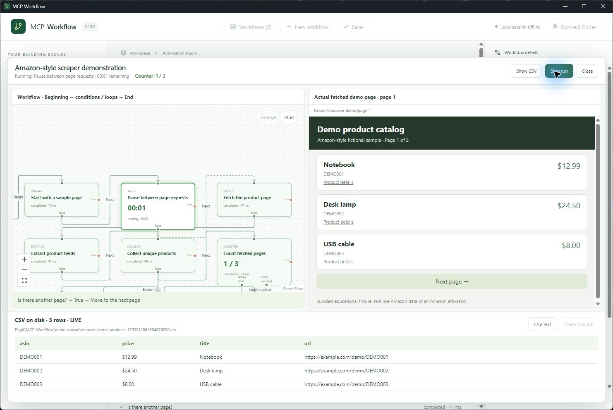
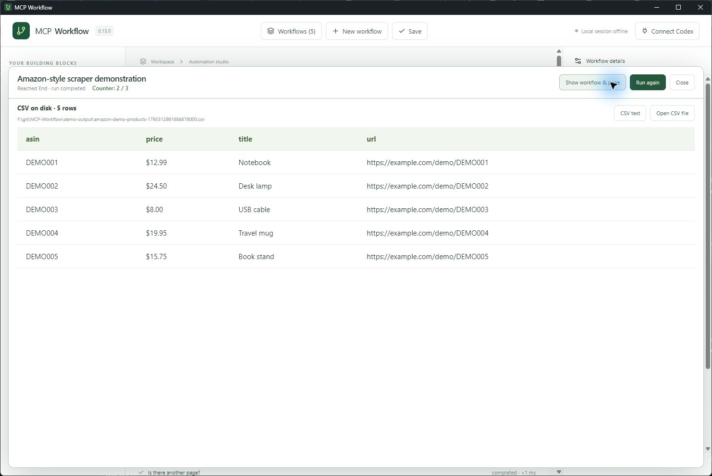
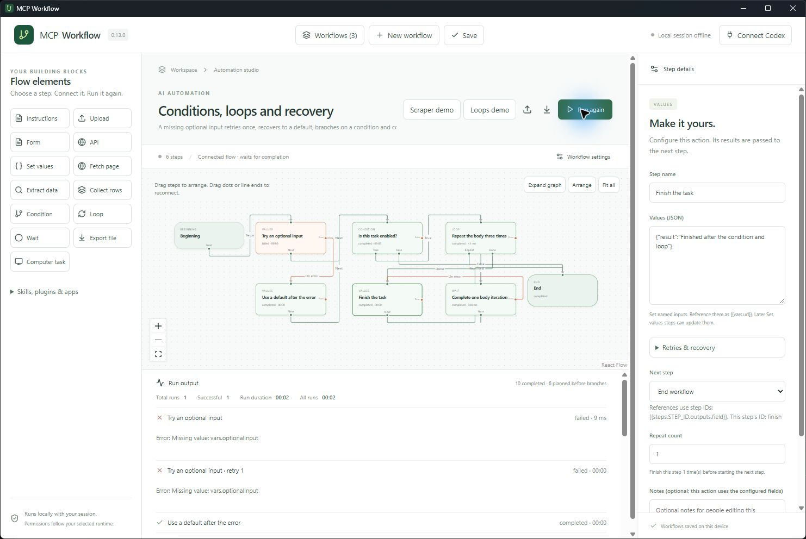
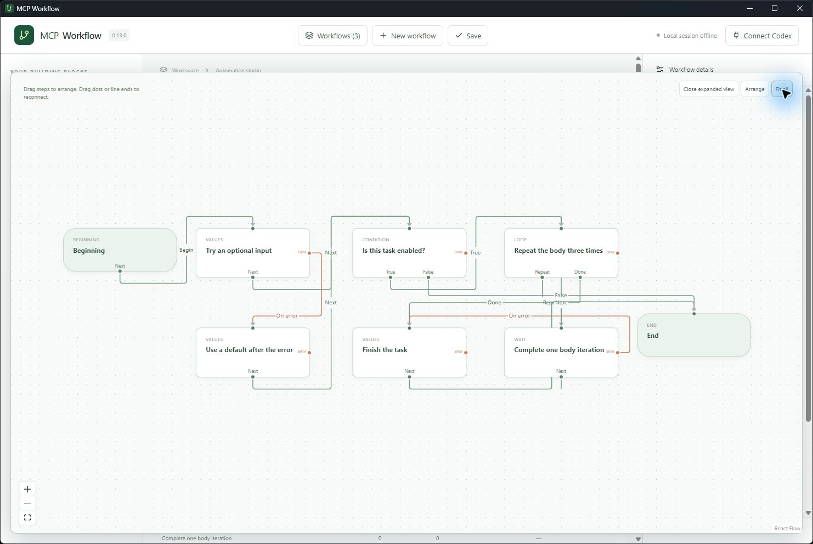
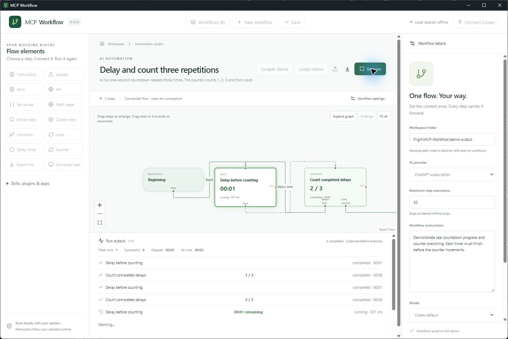
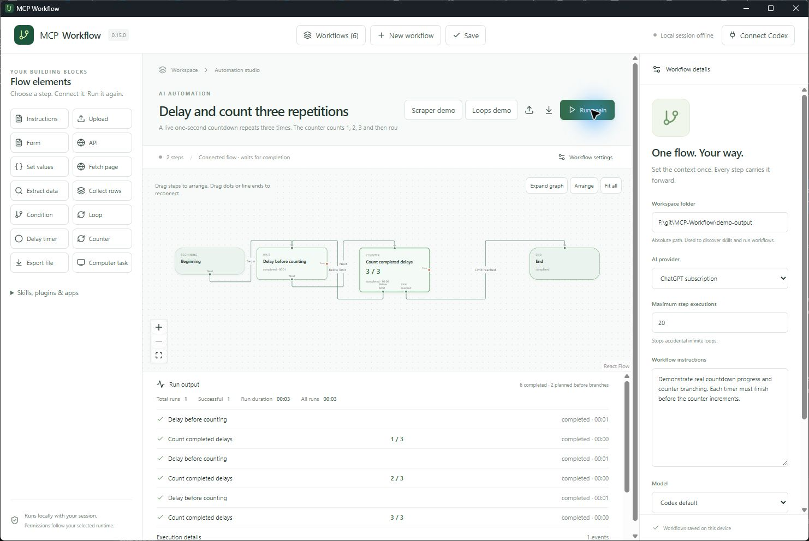

# Building repeatable automations

## Start small

1. Choose an existing workspace folder in **Workflow settings**.
2. Choose your AI provider if your flow needs AI. Native scraping and direct API steps run without an AI account.
3. Click an element in the left sidebar, name it, and configure its fields.
4. Leave **Next step** as “Next in list”, or choose a destination to branch or loop.
5. Run, inspect the results, and use **Run again**. Export the workflow JSON to share its definition.

Open **Workflows** to search saved names and descriptions, switch flows, export a specific flow as JSON, or delete it after confirmation. **New workflow** asks for a name and optional description, then opens a blank canvas using the current workspace and provider. Edits autosave; **Save** immediately writes all changes. Change the name and description in the canvas header. Unfinished drafts can be saved, but invalid configuration still prevents execution.

JSON import always creates a separate copy with fresh run statistics, even if its ID matches an existing flow. JSON export contains the current definition, description, settings and file references; it does not bundle uploaded files, credentials or execution history. Deleting a workflow removes its local statistics. Deleting the final workflow opens a fresh blank canvas. Existing single-workflow saves migrate automatically without changing their identity or timing history.

Workflows and cumulative timing statistics are saved on this device. Each run starts with fresh variables and datasets. Files, API writes and computer actions remain external side effects; repeating a run can repeat those actions.

## Generate a draft with AI

**Build with AI** uses the provider and workspace selected in Workflow settings: ChatGPT subscription, Claude subscription, OpenAI API, Claude API or Bedrock. Describe inputs, desired output, branch rules, repeat limits and failure behavior. Generate, inspect the graph and expand the step settings, then save a new workflow. You can reconnect the preview graph or revise the prompt and generate again. Saving does not execute the flow or replace the current workflow.

The builder validates the schema, step IDs and destinations. Every generated step must be reachable from Beginning and have a possible path to End. A possible exit is not proof of successful termination; execution limits still apply. Missing uploads and TODO inputs are flagged. AI-generated CSS selectors need verification against actual HTML. Authentication, provider limits and model access still apply. The builder cannot promise a correct task from ambiguous instructions.

Design uses an isolated read-only Codex thread with shell, web search, apps, plugins and configured MCP servers disabled, or a Claude design-only turn with tools and settings sources disabled. It does not install plugins or run generated actions. Stop interrupts generation; a three-minute limit requests cancellation. Native workflow runs still require separate user action.

## Write useful Instructions

Give the AI a concrete task, inputs, constraints, and completion criteria. For example:

> Read the uploaded supplier quotes. Compare the same quantities and currencies. Fill the next form with supplier name, total, currency and delivery days. If a required fact is missing, report blocked instead of guessing. Finish reading all files before continuing.

A useful document flow is **Upload → Instructions → Form**. Add an API step only after checking the structured answers. Forms generate local structured results; they do not submit a website form.

## Scraper example

Click **Scraper demo** in the workflow header. This adds a separate workflow to your library and keeps your existing flows. Choose a workspace and run it.

The [Amazon-style template](../examples/amazon-scraper-demo.json) uses two bundled HTML pages with fictional products. It makes no Amazon requests and is not affiliated with Amazon. It demonstrates this source-available tool; its noncommercial license is not an OSI open-source license.

To design this example with AI, paste the [complete builder prompt](../examples/amazon-scraper-builder-prompt.txt) into **Build with AI**, review the generated steps, then save. Compare the result with the [workflow diagram](../README.md#prompt--workflow--results). Import the template JSON for the exact recorded graph. The new [prompt-to-results video](demo/amazon-scraper-prompt-to-results.mp4) shows a real generation using that prompt, review of the live CSV setting, and execution of the same generated graph. Its [recorded workflow JSON](demo/ai-scraper-workflow.json) is available to import with your own workspace.

| Step | What it does |
| --- | --- |
| Set values | Starts `url` at the first fixture page |
| Wait | Pauses three seconds before fetching |
| Fetch page | Reads the page, with a three-page cap |
| Extract data | Selects product rows and extracts ASIN, title, price and link |
| Collect rows | Keeps one product per ASIN |
| Counter | Counts fetched pages and caps the workflow at three pages |
| Condition | Checks whether extraction found a next-page link |
| Set values | Updates `url` and routes back to Wait |
| Export file × 2 | Writes CSV and JSON with unique filenames |

Two pages contain six rows, including one duplicate. A successful run exports five products and executes 16 step visits. A second run starts fresh and creates new files. [Example CSV](demo/products.csv) · [Example JSON](demo/products.json).

For a live site you are authorized to scrape, change the first URL, row selector, field selectors and next-link selector. Inspect that site's actual HTML; the demonstration selectors are not a promise of compatibility with live Amazon pages. Fetch checks robots.txt, accepts HTTP(S) without embedded credentials, limits each response to 2 MB and 30 seconds, and retries transient HTTP failures up to twice. It stops on denied robots rules, access errors, CAPTCHA indicators and redirects. Supply the final permitted URL directly. It does not bypass logins or render JavaScript. A **Computer task** can use a compatible browser runtime when available.

## Watch the page and CSV together

Open **Live view** on a scraper workflow. The graph and the actual fetched HTML appear side by side. The bundled fixture may be previewed before a run; live websites appear only when Fetch page actually reads them. The preview is read-only, sandboxed, and blocks scripts and external resources.

Set **Live CSV filename prefix** on Collect rows to write the real file after each batch. New unique rows append to the same CSV during the run, and the viewer displays content read back from disk. The first sample page writes three rows; the second adds two new products. **Show CSV** focuses the final result, **CSV text** displays its raw contents, and **Open CSV file** opens the completed file in your default application. Keep the live file closed in applications that lock it while the workflow writes. Each run creates a fresh filename; a final CSV export reuses its live file. Existing rows and columns cannot be changed midway through a live export.

## Design the graph and recover from failures

Every canvas has nonremovable **Beginning** and **End** nodes. Beginning determines the entry step; it is independent of the list order. All terminating routes point to End. Drag any step to arrange it; positions are saved and included in exported JSON. Drag from an output dot to a step’s input to connect it. Drag either end of an existing line to reconnect it. Condition nodes have True/False outputs, Loop nodes have Repeat/Done outputs, and every action has an Error output. Error paths run after retries are exhausted. **Arrange** resets positions; **Fit all** shows the whole graph; **Expand graph** provides more space. Select a step to edit its settings in the inspector. Removing a step sends its incoming routes to End instead of silently connecting them elsewhere.

In **Retries & recovery**, set 0–10 retries, a delay of 0–60 seconds, and an inactivity timeout of 0–3600 seconds (0 disables it). Default: no retries, a two-second retry delay and a 180-second inactivity timeout. Agent activity resets that timer, and pending user approval pauses it. Inactivity requests interruption; a retry waits for the original attempt to end. Native requests may finish their bounded in-flight operation before stopping. If the runtime cannot confirm termination, another attempt is not started concurrently. Unfinished agent/tool work halts the workflow rather than retrying or redirecting unsafely. Missing credentials or other blocked outcomes skip retries and use the error path, if configured.

Retries restore variables, datasets and step outputs to their state before the failed attempt; they do not undo external API writes, file exports or computer actions. Use idempotent operations or service idempotency keys when needed. Every attempt counts toward the global execution limit and appears separately in the console and timing totals.

Click **Loops demo** to add the [conditions, loops and recovery template](../examples/conditions-and-loops.json). Beginning enters a deliberately missing optional input, which fails twice (initial attempt plus one retry), then follows Error to a default value. The condition chooses the enabled path, a counted loop completes its Wait body three times, and the final step reaches End. Setting the default `enabled` value to false demonstrates the alternate exit. Intentional Delay timers report activity during their countdown, so an ordinary delay is not mistaken for an unresponsive action. These native steps need no AI account.

## Delay timers and counters

A **Delay timer** pauses execution until its countdown reaches zero. Select seconds, minutes, hours or days in the inspector; the graph, console and live monitor show its remaining time. The maximum delay is 365 days while this app remains running. Stop interrupts a delay. Timers do not resume after closing the app. Exported JSON stores the canonical duration as `wait.seconds` and the selected display unit as `wait.unit`; older Wait steps still load as seconds.

A **Counter** counts each completed visit, beginning at one, and publishes `count`, `limit` and `reached` in its outputs. For example, `{{steps.count.outputs.count}}` reads the current count. Choose separate **Below limit** and **Limit reached** destinations, or reconnect their graph handles. Place the Counter after the action you want to count, then route Below limit back to that action. The count remains at/above its limit if revisited later in the same run, and starts fresh on the next run.

Import [counter-and-delay.json](../examples/counter-and-delay.json) to see three real one-second countdowns and counts 1 → 2 → 3 before End. The scraper template counts fetched pages too: its three-page cap is an alternate exit, while the next-page condition normally ends the two-page sample.

## Data references and loops

Set values accepts a JSON object, for example `{"url":"https://example.com/catalog"}`. Read it with `{{vars.url}}`. A full reference preserves its JSON type; references embedded in text become strings. Missing references fail clearly. No expressions or JavaScript are evaluated.

Completed step results use `{{steps.STEP_ID.outputs.field}}`. Each inspector shows its step ID. Extract and Collect offer source-step pickers. Native direct API URLs, headers and body also accept references. Use a whole reference such as `{{steps.form.outputs}}` as the body to send typed form data as JSON, or `{{vars.headers}}` for a string-valued header object. AI steps receive completed results, variables and collected datasets as reference data, capped at 250,000 characters.

A **Condition** chooses its true/false destination. Choose an earlier step to form a pagination loop. A **Loop** runs a fixed number of iterations: choose its body and exit, then route the last body step back to the Loop. The gate runs once more to exit after its final iteration. Each step also has a Repeat count. Set **Maximum step executions** to bound the whole graph; a cap or error stops the run instead of silently skipping work.

## Providers and dependencies

| Provider | Setup |
| --- | --- |
| ChatGPT subscription | Install Codex, use its sign-in, then Connect Codex |
| Claude subscription | Install Claude Code and Node.js 20+, sign in with the `claude` CLI |
| OpenAI API | Install/connect Codex, set `OPENAI_API_KEY` before launching, enter a model ID |
| Claude API | Install Claude Code and Node.js 20+, set `ANTHROPIC_API_KEY`, optionally enter a model |
| Amazon Bedrock | Install Claude Code and Node.js 20+, configure AWS credentials/profile, region and an accessible model/inference-profile ID |

Subscription credentials stay with the official runtimes. The app does not copy OAuth tokens or browser cookies. API settings store environment-variable names, not keys. For direct API headers, `env:VARIABLE_NAME` resolves in the Rust backend. Do not paste secrets into instructions, documentation, headers or exported workflow files. Run **Check provider runtime** to check prerequisites; authentication and model access are verified during execution.

Codex automatically discovers its local skills, plugins and connected apps, and selects/downloads needed permitted plugins before AI runs. Expand **Skills, plugins & apps → Get plugins** to browse the ChatGPT/Codex catalog. Remote dependencies are refreshed when needed; enabled installed skills are reused. Account policies and required sign-ins still apply. Claude loads its own user/project skills, plugins and MCP configuration through the official Agent SDK. The two providers' catalogs are not interchangeable. Computer control depends on the selected runtime and permissions and stops if unavailable.

References: [Claude plan usage](https://support.claude.com/en/articles/15036540-use-the-claude-agent-sdk-with-your-claude-plan), [Agent SDK](https://code.claude.com/docs/en/agent-sdk/typescript), [Bedrock](https://code.claude.com/docs/en/amazon-bedrock), [Codex configuration](https://learn.chatgpt.com/docs/config-file/config-reference).

## Run behavior and verification

Only a successful completed outcome allows routing onward. The agent must finish its tools and delegated work; unfinished work, denied/missing requirements or invalid required form answers stop execution. 

The active step glows. Fast actions show milliseconds. The console reports each visit's duration, total run time, total runs, successful runs and per-step average successful duration. Branches can execute more or fewer steps than the initial linear plan.

Stopping a native network request waits for the in-flight request (up to 30 seconds, plus bounded retries). Stopping cannot undo completed file writes, API writes or computer actions. CSV exports quote fields and prefix formula-like values for safer spreadsheet opening; JSON preserves the original values. Exports never overwrite existing files.

Use **Schedules** to choose a saved workflow and repeat it every X minutes, hours or days, every day at a local time, or once on a selected date and time. The first interval-based run starts after one interval; a one-time schedule disables itself after its slot. Pause/enable/remove schedules and inspect the next run and started/skipped counts. Schedules stay on this device and are not imported/exported with workflow JSON.

The app must stay open and the computer awake. Only one flow runs at a time per app window; busy slots are skipped. Open dialogs also skip due slots to avoid switching workflows while you edit. Runs over 30 seconds late are skipped and missed intervals never replay a backlog. Times use the computer's local timezone. Keep a single app instance open. AI approvals still require interaction; operating-system background execution and automatic sign-in are not implemented.

Developer checks: `npm run check`, `cargo test --manifest-path src-tauri/Cargo.toml`, `npm run desktop:build`. The test suite includes graph routing, loop limits, scraper pagination/deduplication, native CRUD requests, form validation, completion guards, plugin policy and provider environment isolation. A live Claude test reached the official runtime but failed on an expired OAuth token; reauthentication is required. Paid API and Bedrock inference were not exercised. The recorded scraper uses the real desktop app with bundled fixtures.

Environment overrides: `MCP_WORKFLOW_CODEX` and `MCP_WORKFLOW_CLAUDE` select installed runtime executables. Claude's helper is bundled at build time; Node.js and Claude Code remain runtime prerequisites.
