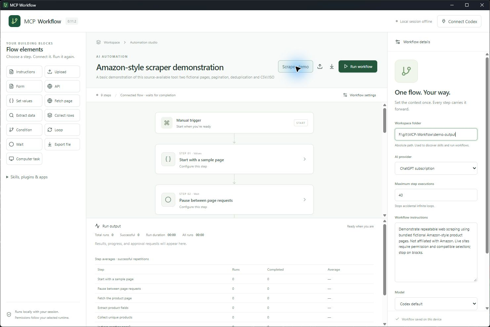
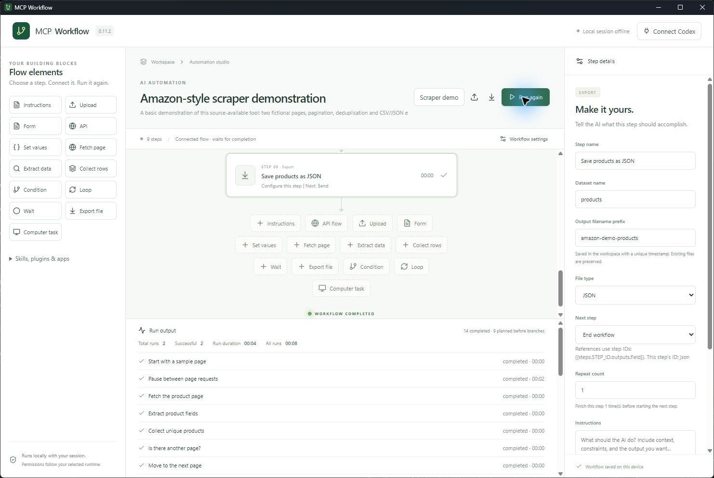
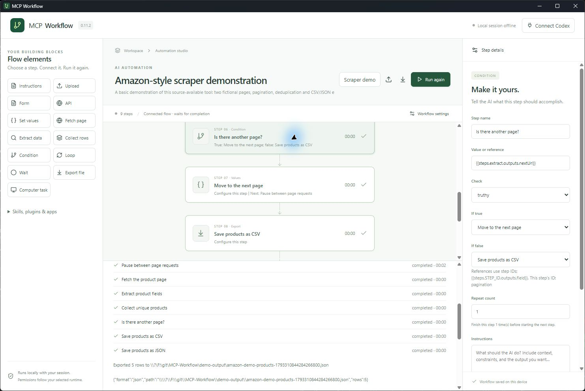
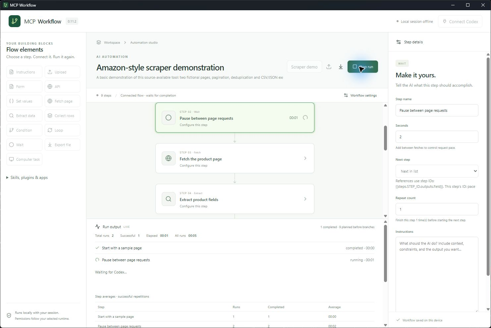
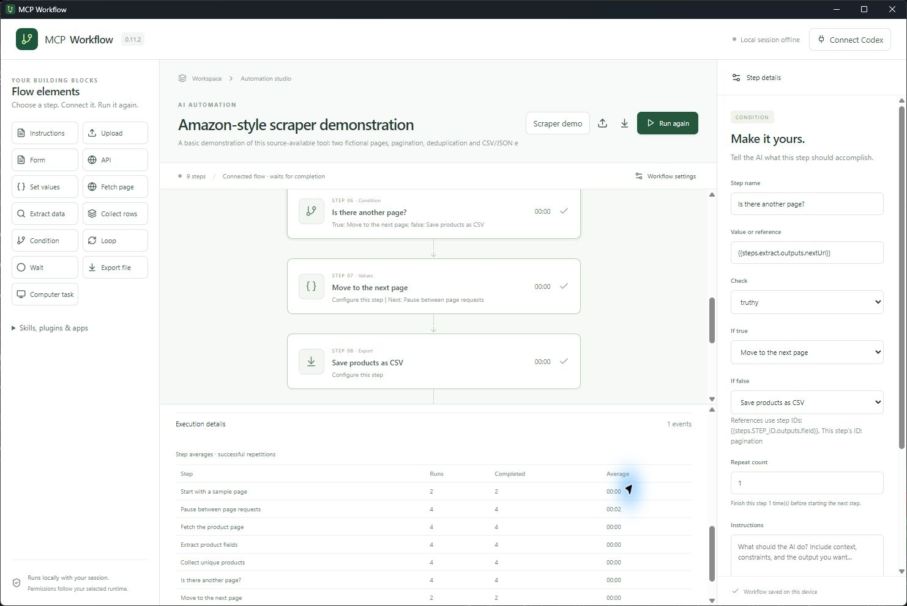

# Building repeatable automations

## Start small

1. Choose an existing workspace folder in **Workflow settings**.
2. Choose your AI provider if your flow needs AI. Native scraping and direct API steps run without an AI account.
3. Click an element in the left sidebar, name it, and configure its fields.
4. Leave **Next step** as “Next in list”, or choose a destination to branch or loop.
5. Run, inspect the results, and use **Run again**. Export the workflow JSON to share its definition.

Workflows and cumulative timing statistics are saved on this device. Each run starts with fresh variables and datasets. Files, API writes and computer actions remain external side effects; repeating a run can repeat those actions.

## Write useful Instructions

Give the AI a concrete task, inputs, constraints, and completion criteria. For example:

> Read the uploaded supplier quotes. Compare the same quantities and currencies. Fill the next form with supplier name, total, currency and delivery days. If a required fact is missing, report blocked instead of guessing. Finish reading all files before continuing.

A useful document flow is **Upload → Instructions → Form**. Add an API step only after checking the structured answers. Forms generate local structured results; they do not submit a website form.

## Scraper example

Click **Scraper demo** in the workflow header. This replaces the current definition; export any flow you want to keep first. Choose a workspace and run it.

The [Amazon-style template](../examples/amazon-scraper-demo.json) uses two bundled HTML pages with fictional products. It makes no Amazon requests and is not affiliated with Amazon. It demonstrates this source-available tool; its noncommercial license is not an OSI open-source license.

| Step | What it does |
| --- | --- |
| Set values | Starts `url` at the first fixture page |
| Wait | Pauses two seconds before fetching |
| Fetch page | Reads the page, with a three-page cap |
| Extract data | Selects product rows and extracts ASIN, title, price and link |
| Collect rows | Keeps one product per ASIN |
| Condition | Checks whether extraction found a next-page link |
| Set values | Updates `url` and routes back to Wait |
| Export file × 2 | Writes CSV and JSON with unique filenames |

Two pages contain six rows, including one duplicate. A successful run exports five products and executes 14 step visits. A second run starts fresh and creates new files. [Example CSV](demo/products.csv) · [Example JSON](demo/products.json).

For a live site you are authorized to scrape, change the first URL, row selector, field selectors and next-link selector. Inspect that site's actual HTML; the demonstration selectors are not a promise of compatibility with live Amazon pages. Fetch checks robots.txt, accepts HTTP(S) without embedded credentials, limits each response to 2 MB and 30 seconds, and retries transient HTTP failures up to twice. It stops on denied robots rules, access errors, CAPTCHA indicators and redirects. Supply the final permitted URL directly. It does not bypass logins or render JavaScript. A **Computer task** can use a compatible browser runtime when available.

## Data references and loops

Set values accepts a JSON object, for example `{"url":"https://example.com/catalog"}`. Read it with `{{vars.url}}`. A full reference preserves its JSON type; references embedded in text become strings. Missing references fail clearly. No expressions or JavaScript are evaluated.

Completed step results use `{{steps.STEP_ID.outputs.field}}`. Each inspector shows its step ID. Extract and Collect offer source-step pickers. Native direct API URLs, headers and body also accept references. Use a whole reference such as `{{steps.form.outputs}}` as the body to send typed form data as JSON, or `{{vars.headers}}` for a string-valued header object. AI steps receive completed results, variables and collected datasets as reference data, capped at 250,000 characters.

A **Condition** chooses its true/false destination. Choose an earlier step to form a pagination loop. A **Loop** runs a fixed number of iterations: choose its body and exit, then route the last body step back to the Loop. The gate runs once more to exit after its final iteration. Each step also has a Repeat count. Set **Maximum step executions** to bound the whole graph; a cap or error stops the run instead of silently skipping work.

## Providers and dependencies

| Provider | Setup |
| --- | --- |
| ChatGPT subscription | Install Codex, use its sign-in, then Connect Codex |
| Claude subscription | Install Claude Code and Node.js 20+, sign in with the `claude` CLI |
| OpenAI API | Install/connect Codex, set `OPENAI_API_KEY` before launching, enter a model ID |
| Claude API | Install Claude Code and Node.js 20+, set `ANTHROPIC_API_KEY`, optionally enter a model |
| Amazon Bedrock | Install Claude Code and Node.js 20+, configure AWS credentials/profile, region and an accessible model/inference-profile ID |

Subscription credentials stay with the official runtimes. The app does not copy OAuth tokens or browser cookies. API settings store environment-variable names, not keys. For direct API headers, `env:VARIABLE_NAME` resolves in the Rust backend. Do not paste secrets into instructions, documentation, headers or exported workflow files. Run **Check provider runtime** to check prerequisites; authentication and model access are verified during execution.

Codex automatically discovers its local skills, plugins and connected apps, and selects/downloads needed permitted plugins before AI runs. Expand **Skills, plugins & apps → Get plugins** to browse the ChatGPT/Codex catalog. Remote dependencies are refreshed when needed; enabled installed skills are reused. Account policies and required sign-ins still apply. Claude loads its own user/project skills, plugins and MCP configuration through the official Agent SDK. The two providers' catalogs are not interchangeable. Computer control depends on the selected runtime and permissions and stops if unavailable.

References: [Claude plan usage](https://support.claude.com/en/articles/15036540-use-the-claude-agent-sdk-with-your-claude-plan), [Agent SDK](https://code.claude.com/docs/en/agent-sdk/typescript), [Bedrock](https://code.claude.com/docs/en/amazon-bedrock), [Codex configuration](https://learn.chatgpt.com/docs/config-file/config-reference).

## Run behavior and verification

Only a successful completed outcome allows routing onward. The agent must finish its tools and delegated work; unfinished work, denied/missing requirements or invalid required form answers stop execution. 

The active step glows. Fast actions show milliseconds. The console reports each visit's duration, total run time, total runs, successful runs and per-step average successful duration. Branches can execute more or fewer steps than the initial linear plan.

Stopping a native network request waits for the in-flight request (up to 30 seconds, plus bounded retries). Stopping cannot undo completed file writes, API writes or computer actions. CSV exports quote fields and prefix formula-like values for safer spreadsheet opening; JSON preserves the original values. Exports never overwrite existing files.

Execution is manual in this release. Schedules, unattended background operation, visual drag-and-drop graph wiring, and automatic sign-in are not implemented.

Developer checks: `npm run check`, `cargo test --manifest-path src-tauri/Cargo.toml`, `npm run desktop:build`. The test suite includes graph routing, loop limits, scraper pagination/deduplication, native CRUD requests, form validation, completion guards, plugin policy and provider environment isolation. A live Claude test reached the official runtime but failed on an expired OAuth token; reauthentication is required. Paid API and Bedrock inference were not exercised. The recorded scraper uses the real desktop app with bundled fixtures.

Environment overrides: `MCP_WORKFLOW_CODEX` and `MCP_WORKFLOW_CLAUDE` select installed runtime executables. Claude's helper is bundled at build time; Node.js and Claude Code remain runtime prerequisites.
